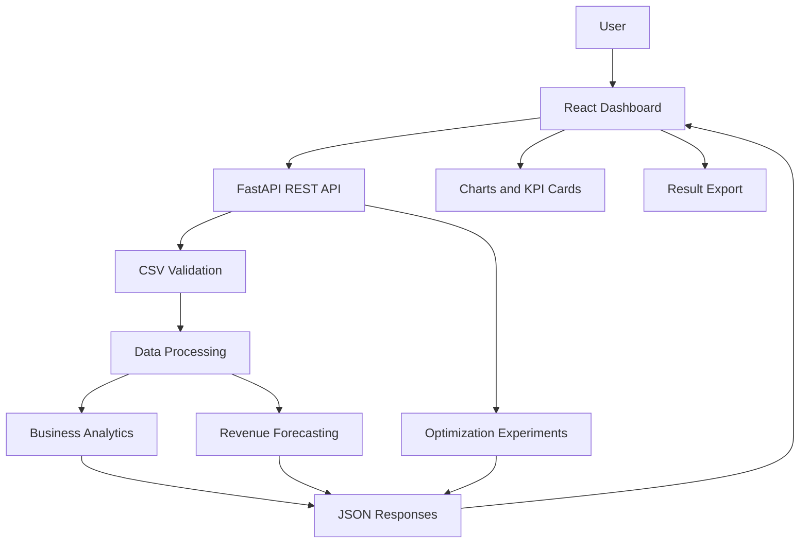

# System Architecture — Restaurant Intelligence Platform

## 1. Overview

The Restaurant Intelligence Platform follows a client-server architecture. The frontend provides the user interface, while the backend validates uploaded data, performs analytics, generates forecasts, and runs optimization experiments.

## 2. Technology Layers

### 2.1 Frontend

**Technologies:** React, Vite, TypeScript, Tailwind CSS, Plotly.

Responsibilities:
- Provide the dashboard interface.
- Allow CSV file selection and upload.
- Display validation messages and loading states.
- Present business KPIs, charts, forecasting results, and optimizer comparisons.
- Allow supported results to be downloaded.

### 2.2 Backend API

**Technologies:** Python and FastAPI.

Responsibilities:
- Expose documented REST API endpoints.
- Receive uploaded files and validate requests.
- Coordinate data processing and analysis.
- Return structured JSON responses and downloadable results.
- Handle errors consistently.

### 2.3 Data Processing

**Technologies:** Pandas and NumPy.

Responsibilities:
- Read and validate CSV data.
- Normalize supported columns and data types.
- Calculate revenue and order-level metrics.
- Aggregate sales by date, product, and category when possible.

### 2.4 Forecasting

**Technology:** Scikit-learn.

Responsibilities:
- Prepare historical daily revenue data.
- Train and evaluate an appropriate baseline forecasting model.
- Use chronological training and test periods.
- Report MAE and RMSE.
- Produce future revenue estimates when sufficient data is available.

### 2.5 Optimization Experiments

**Technologies:** NumPy and SciPy, as appropriate.

Responsibilities:
- Define a common objective function.
- Run Gradient Descent, Adam, and Newton's method under documented conditions.
- Record loss, iteration count, execution time, and convergence behavior.
- Return comparable results for visualization.

Forecast accuracy and optimization convergence are evaluated separately.

### 2.6 Storage

The initial version processes uploaded data in memory and does not require persistent database storage. SQLite may be introduced later if the application needs to retain datasets or analysis history.

## 3. System Data Flow

1. The user opens the web dashboard.
2. The user selects a restaurant sales CSV file.
3. The frontend sends the file to the FastAPI backend.
4. The backend validates the file and required columns.
5. Pandas and NumPy process the validated data.
6. The backend calculates analytics and, when supported, forecasting results.
7. The optimization module runs the selected algorithm comparison independently.
8. The backend returns structured results to the frontend.
9. React and Plotly display the results.
10. The user downloads supported analysis outputs.

## 4. Architecture Diagram

## 5. API Communication

The frontend communicates with the backend using HTTP requests.

- CSV uploads use multipart/form-data.
- Analysis results use JSON.
- Export endpoints return downloadable files.
- Errors use appropriate HTTP status codes and understandable messages.

The local development frontend and backend may run on different ports, so the backend must be configured to allow requests from the frontend development origin.

## 6. Security and Reliability

- Validate file types and file sizes.
- Reject malformed datasets with clear errors.
- Avoid returning stack traces to users.
- Configure allowed frontend origins explicitly.
- Keep secrets and environment-specific configuration outside committed source code.
- Test invalid input and insufficient-data scenarios.

## 7. Testing Strategy

### Backend
- CSV validation tests
- KPI calculation tests
- Forecasting and evaluation tests
- Optimization comparison tests
- API endpoint tests

### Frontend
- Component and interaction tests
- Upload and validation-message tests
- Loading, empty, and error-state tests
- Result-display tests

### Integration
- Verify that the frontend can upload a file and display backend results.
- Verify error handling for invalid datasets.
- Verify that exports contain the expected data.

## 8. Deployment

The frontend and backend will be configured for deployment to a suitable hosting platform. Deployment settings, environment variables, API URLs, and cross-origin configuration must be documented.

## 9. Architectural Constraints

- Prioritize the MVP within the 15-day development schedule.
- Avoid introducing unnecessary infrastructure before core features work.
- Keep analytics, forecasting, and optimization logic in separate modules.
- Document limitations and assumptions explicitly.
